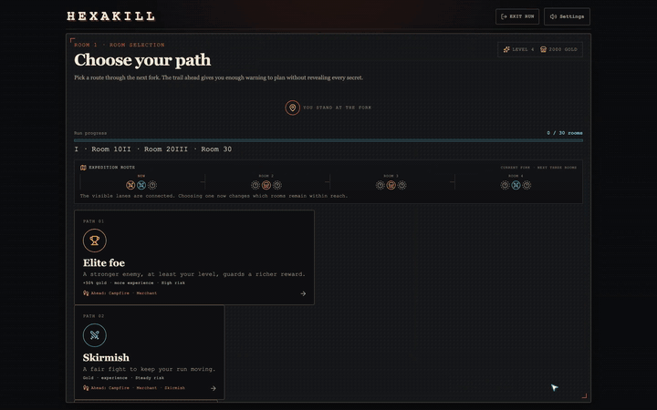
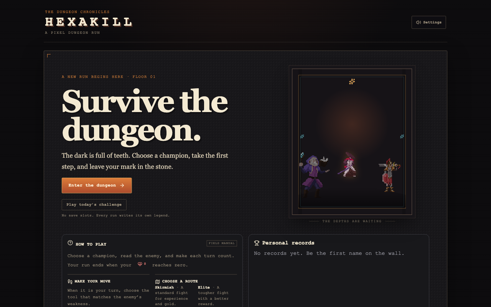
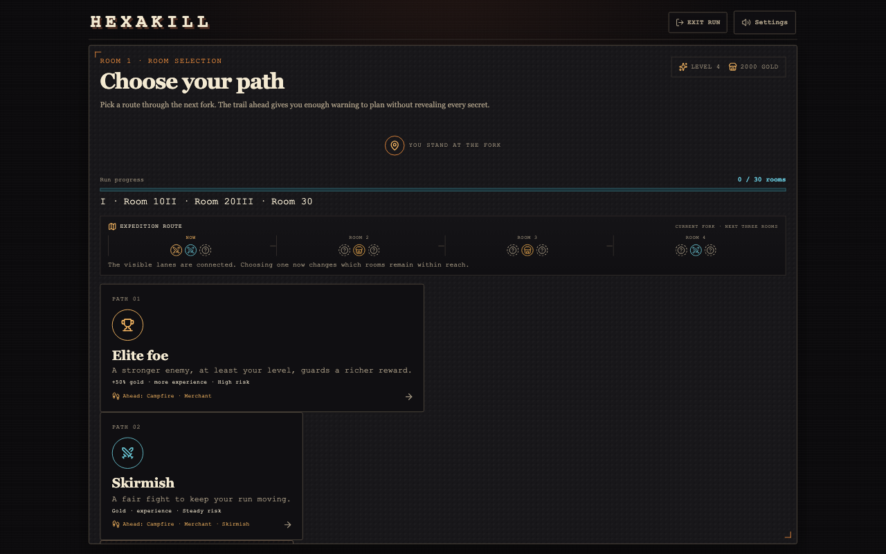
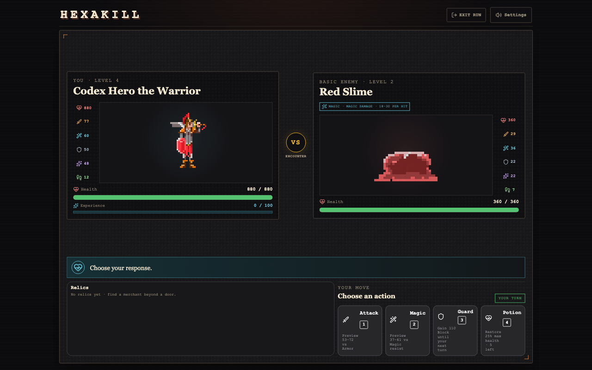

# Hexakill

**A turn-based pixel roguelike about reading enemy intent and choosing your route.**

[Play Hexakill](https://hexakill.vercel.app) · [Architecture](docs/ARCHITECTURE.md) · [Architecture decisions](docs/adr/README.md)

[](https://github.com/dawichi/hexakill/actions/workflows/ci.yml)



| Welcome | Route map | Combat |
| --- | --- | --- |
|  |  |  |

## The game

- Choose a path through a seeded, branching 30-room expedition.
- Read enemy intents, then use Attack, Magic, Guard, or Potion to answer them.
- Build a run from 30 passive relics across three tiers and six stat power-ups.
- Face the Fire Knight, Water Priestess, and Bringer of Death at milestone rooms.
- Replay a shared seed or take on the UTC daily challenge. Records stay in your browser.

## Engineering

- Framework-independent TypeScript domain rules resolve turns and emit typed combat events.
- Angular signals coordinate the run, while clock, audio, random, and storage ports keep browser effects at the application boundary.
- Seeded route generation and a persisted random cursor reproduce route, combat, and shop outcomes after reload.
- Valibot validates versioned local saves before the game restores them.
- The headless balance simulator calls the same domain transitions as the game.
- Vitest and Playwright cover domain rules and browser journeys against development and production builds.

**Stack:** Angular 21 · TypeScript 5.9 · Bun · Vitest · Playwright · Biome

## Run locally

```sh
bun install
bun run start
```

Open `http://localhost:4200`. Run the checks and simulator with:

```sh
bun run check
bun run verify:types
bun run test -- --watch=false --no-progress
bun run test:e2e
bun run build
bun run simulate:full-run
```

The simulator accepts `SIM_SAMPLES` and `SIM_SEED`; set `SIM_RELICS=1` to compare relic effects.
See [the balance lab](docs/balance-simulation.md) for examples.

## Project history

The game began in React in 2021, moved to SvelteKit, and was rebuilt in Angular in 2026.

## Asset credits and licensing

The owner recalls that the bundled character and enemy art, music, and sound came from a free
asset library, but the library, creators, licenses, and attribution terms are no longer known.
The files remain in this local-comparison build without a claim of ownership or cleared
redistribution rights. The planned follow-up is to replace the bundle with original
AI-generated assets; that work is not part of this update.
