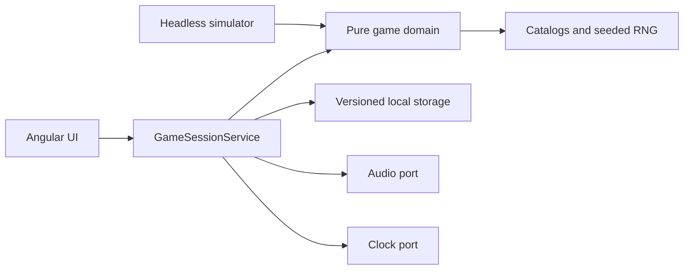
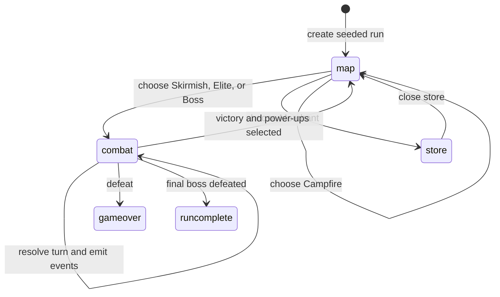

# Architecture

Hexakill is a browser-only game. The browser stores the active run, local records, and
preferences; there is no account service or game backend.

## Boundaries



- `src/app/domain/` owns run, route, combat, progression, relic, record, and preference rules. It
  does not import Angular.
- `src/app/application/` coordinates domain changes and browser effects through storage, audio,
  and clock ports. `GameSessionService` is the UI-facing application boundary; session views,
  persistence, and screen music selection live in focused modules beside it.
- `src/app/app.ts` renders the shell and delegates each screen to an OnPush standalone component
  under `src/app/screens/`. Shared UI components live under `src/app/components/`, screen and
  combat styles are split into ordered modules under `src/app/styles/`, and pure display formatting
  and event messages live under `src/app/ui/`.
- `src/sim/` and `tools/simulate.ts` run deterministic balance reports without launching Angular.
- `static/` contains the retained images, music, and sound effects. Their origins and license terms
  still need to be confirmed; see the credits note in the [README](../README.md#asset-credits-and-licensing).

## Run and combat flow



`domain/combat.ts` resolves a turn synchronously and returns the new combat state plus typed
events. The application saves the state before its presentation queue plays those events as
messages, sounds, sprite animation, and feedback. The queue can be skipped; it does not change the
outcome. Reloading during presentation resumes from the already committed result.

`application/session-view-model.ts` derives the screen, route, combat, and character display state
from the current run. `application/session-persistence.ts` owns validation and migration at the
browser-storage boundary. `ui/combat-messages.ts` formats combat events for the live message region;
presentation timing and sound playback stay in the application layer.

Intent is part of combat state. Enemy archetypes favor different actions. Bosses use named moves;
the Fire Knight telegraphs a heavy strike, the Water Priestess attacks in multiple hits, and the
Bringer of Death uses charged attacks. Guard creates temporary Block, consumed independently by
each incoming hit.

## Routes and randomness

The run seed generates a connected 30-room graph. Its visited node IDs identify the path taken;
future nodes are reconstructed from the seed. Regular rooms contain Skirmishes, Elites, Merchants,
and Campfires. The milestone bosses are the Fire Knight (room 10), Water Priestess (room 20), and
Bringer of Death (room 30).

The run also stores the 32-bit random generator cursor. Combat and shop changes advance it, so a
reload reproduces the next random result. `?seed=<code>` selects a shareable seed. A daily seed is
derived from the UTC date and uses its own records list.

## Browser storage

| Key | Contents |
| --- | --- |
| `hexakill.session.v2` | Seed, RNG cursor, player, visited route, screen, combat, reward, and store offers |
| `hexakill.records.v2` | Best five ordinary runs |
| `hexakill.daily-records.v2` | Best five runs for the daily challenge |
| `hexakill.preferences.v2` | Volume, mute, and combat text speed |

`application/run-storage.ts` uses Valibot to validate saved structure, then checks route and
screen-state coherence before restoring it. Invalid saves are discarded. In-progress v1 runs are
not migrated. Presentation timers and queued events are never persisted. Records rank wins first,
then rooms cleared, then level.

## Checks and simulator

```sh
bun run check
bun run verify:types
bun run test -- --watch=false --no-progress
bun run test:e2e
bun run build
bun run verify:assets
```

Run `bun run simulate:full-run` for class and route-policy completion rates. Set `SIM_SAMPLES` and
`SIM_SEED` to change the batch; set `SIM_RELICS=1` to compare relic effects. The simulator calls
the same domain transitions as the app. See the [balance lab](balance-simulation.md).

Asset verification checks active paths and sprite-strip geometry. It does not determine ownership,
copyright, license, or attribution rights.
